# Product Requirements Document: Coordina

**Autonomous AI Project & Team Coordinator**

| | |
| --- | --- |
| **Product** | Coordina |
| **Problem statement** | W-PS-1 (Kurukshetra hackathon) |
| **Document status** | v1.0, describes the built prototype plus the planned roadmap |
| **Last updated** | 17 October 2026 |
| **Platforms** | Desktop web dashboard, Android companion (PWA), Telegram bot, GitHub integration |

---

## Table of contents

1. [Summary](#1-summary)
2. [Problem](#2-problem)
3. [Goals and non-goals](#3-goals-and-non-goals)
4. [Users and personas](#4-users-and-personas)
5. [User stories](#5-user-stories)
6. [Core concepts](#6-core-concepts)
7. [Functional requirements](#7-functional-requirements)
8. [Key workflows](#8-key-workflows)
9. [System architecture](#9-system-architecture)
10. [AI design](#10-ai-design)
11. [Data model](#11-data-model)
12. [API surface](#12-api-surface)
13. [Non-functional requirements](#13-non-functional-requirements)
14. [Tech stack](#14-tech-stack)
15. [Configuration](#15-configuration)
16. [Success metrics](#16-success-metrics)
17. [Testing and acceptance](#17-testing-and-acceptance)
18. [Risks and mitigations](#18-risks-and-mitigations)
19. [Roadmap](#19-roadmap)
20. [Open questions](#20-open-questions)

---

## 1. Summary

Coordina is an AI coordinator that runs a team's follow-up loop on its own. It checks in with each teammate, understands free-text replies (English, Hinglish, sarcasm, voice notes), separates real progress from blockers, refuses "done" claims that contradict the dependency chain, and messages the one teammate who can unblock the work. Every change appears live on every screen.

It serves two kinds of team with the same engine:

- **College group projects:** a team lead and 3 to 6 students working to a submission deadline.
- **Company sprints:** an engineering team with roles, SLAs, Jira/Linear tasks and GitHub commits.

---

## 2. Problem

Group projects rarely fail because the work is hard. They fail because of coordination:

| Pain | What happens today |
| --- | --- |
| **Nobody knows who is stuck** | Blockers sit silently in someone's head until the deadline |
| **Hidden dependencies** | Meera can't finish integration until Kabir finishes the API, but nobody tracks that |
| **"Basically done" ≠ done** | Status updates are optimistic. Partial progress gets reported as complete. |
| **Chasing is a full-time job** | The team lead spends their time sending "any update?" messages |
| **Updates are scattered** | Progress lives in WhatsApp, Telegram, commits and memory, never in one place |
| **Late escalation** | Managers hear about a blocker after it has already delayed downstream work |

Existing tools (Jira, Trello, Notion) are **passive**: they record status only if someone types it in correctly. Coordina is **active**: it asks, interprets, verifies and acts.

---

## 3. Goals and non-goals

### Goals

| ID | Goal |
| --- | --- |
| G1 | Remove manual chasing: the coordinator follows up on its own |
| G2 | Turn messy natural-language replies into accurate task status |
| G3 | Detect blockers and route them to the person who can resolve them, within seconds |
| G4 | Prevent "illusion of progress": refuse completions that contradict dependencies, and ask for proof |
| G5 | Keep every screen and channel in sync in real time |
| G6 | Work reliably during a live demo: no API keys, no internet and no Telegram token required |
| G7 | Support both college and company teams with the same product |

### Non-goals (for v1)

- Replacing Jira or Linear as a full issue tracker (no sprints, story points or boards with swimlanes).
- Time tracking, payroll or performance reviews.
- Native iOS app or an APK. Android is served as a PWA.
- Multi-tenant cloud hosting. v1 runs on one laptop with SQLite.

---

## 4. Users and personas

| Persona | Example | Needs | Main surfaces |
| --- | --- | --- | --- |
| **Team Lead (college)** | Project lead of a capstone team | Plan the project, see who is stuck, avoid chasing, show faculty real progress | Desktop dashboard, Standup report |
| **Team Lead (company)** | Engineering manager or scrum master | Sprint health, SLA on blockers, escalation only when needed | Desktop dashboard, Slack, report |
| **Team Member** | Kabir (Payment API), Meera (Integration) | Send updates quickly, get unblocked fast, know what to do next | Telegram, Android companion |
| **Manager / PM** | Product owner in a company sprint | Hear about blockers only when they are truly stuck | Telegram / Slack escalations |
| **Evaluator** | Faculty or hackathon judge | Trustworthy view of who did what | Report, verified badges |

### Roles and permissions

| Action | Team Lead | Member |
| --- | --- | --- |
| Create a project (manual, AI plan, GitHub repo, CSV) | ✅ | ❌ |
| Add or edit members and tasks, set deadlines | ✅ | ❌ |
| Update any task / override status / approve completion | ✅ | ❌ |
| Update own tasks | ✅ | ✅ |
| Toggle Auto-Pilot, strict dependency lock, integrations | ✅ | ❌ |
| View dashboard, feed and report | ✅ | ✅ (own project) |

---

## 5. User stories

### Team Lead
- **US-1** As a lead, I paste a GitHub repo URL and get a task plan split by role, with dependencies and deadlines, so I don't plan by hand.
- **US-2** As a lead, I turn on Auto-Pilot so check-ins happen without me.
- **US-3** As a lead, I see each task's status, latest note and blocker on one board, updated live.
- **US-4** As a lead, I open a standup and risk report that tells me the bottlenecks and what to do next.
- **US-5** As a lead, I share an invite link or QR code so members join in seconds.
- **US-6** As a lead, I approve or override a completion when the AI can't verify it.

### Team Member
- **US-7** As a member, I reply in plain words ("API done, but waiting for keys from Meera") and the board updates correctly.
- **US-8** As a member, when I'm blocked, the right teammate is told without me chasing them.
- **US-9** As a member, when someone is blocked on me, I see a banner and can unblock them in one tap.
- **US-10** As a member, I can send an update by voice on my phone.
- **US-11** As a member, I can share my availability so the team can find a meeting slot.
- **US-12** As a member, I can prove my work with a commit link, a deliverable link, or a screenshot.

### Company team
- **US-13** As an engineer, my commit message "Connected webhook, blocked on KMS keys from Priya" updates the board and pings Priya.
- **US-14** As a manager, I'm escalated to only when a blocker passes its SLA twice.
- **US-15** As a lead, I import an existing sprint from a Jira/Linear CSV.

---

## 6. Core concepts

| Concept | Definition |
| --- | --- |
| **Project** | One team's workspace, of type `college` or `company`. Has an invite code, an optional GitHub repo, a start and due date. |
| **Participant** | A teammate in a project. Has a role, a unique 6-digit PIN for Telegram verification, and availability. |
| **Task** | A unit of work with one owner, a status, a progress note, an optional blocker, and an optional upstream task it depends on. |
| **Dependency** | `Task B depends on Task A`: B can't be honestly completed while A is Blocked (or not Complete, in strict mode). |
| **At risk** | A task whose upstream task is Blocked. Shown as a warning on the board. |
| **Relay** | A message the coordinator sends to the teammate who can resolve a blocker. |
| **Auto-unblock** | When a helper's message resolves a blocker, the blocked task returns to In Progress and its owner is told. |
| **Handoff** | When a task completes, everyone whose task depends on it is notified. |
| **Contradiction guard** | Refuses a completion claim that conflicts with an unfinished upstream task. |
| **Proof level** | How a completion is verified: `github` (commit/PR), `deliverable` (link or file), `lead` (approved), or `self` (unverified). |
| **Agent log** | Every message, AI decision and alert, kept as an audit trail and shown as the coordinator feed. |

### Task status state machine

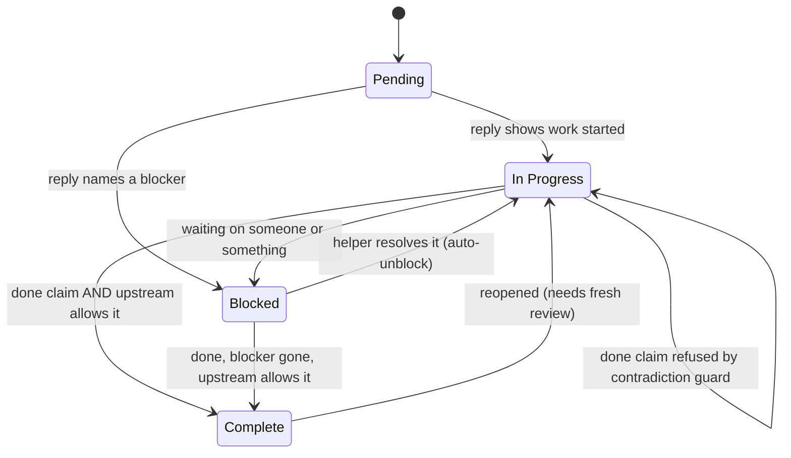

---

## 7. Functional requirements

Priority: **P0** = must have for the demo (built), **P1** = built, important, **P2** = planned.

### 7.1 Project setup

| ID | Requirement | Priority | Status |
| --- | --- | --- | --- |
| FR-1 | Lead can register or log in with a password, or use a one-click demo account | P0 | Built |
| FR-2 | Lead can create a project manually (name, description, workspace type) | P0 | Built |
| FR-3 | AI generates a project plan (roles, tasks, dependencies, deadlines) from a name, a description and teammate names | P1 | Built |
| FR-4 | AI generates a plan from a GitHub repo: detects stack, dependencies and README features, assigns tasks by role, and briefs each member on Telegram | P1 | Built |
| FR-5 | Lead can import tasks from a Jira/Linear CSV, into the active or a new project | P1 | Built |
| FR-6 | Lead can load demo presets: "College Capstone" and "Company Sprint" | P0 | Built |
| FR-7 | Lead sets a project start and due date; task deadlines are spread across working time automatically | P1 | Built |
| FR-8 | Members join with an invite code or link (QR); each member gets a unique 6-digit PIN | P0 | Built |

### 7.2 Check-ins and replies

| ID | Requirement | Priority | Status |
| --- | --- | --- | --- |
| FR-9 | Lead can ping one task's owner, or all pending tasks, with a check-in | P0 | Built |
| FR-10 | Members reply from Telegram, the Android companion, the dashboard tester, or a GitHub commit, and all go through the same agent loop | P0 | Built |
| FR-11 | The system interprets the reply into: status, progress note, blocker reason, blocked-by teammate, availability, and confidence | P0 | Built |
| FR-12 | Mixed messages ("done X, but waiting for Y") become **Blocked**, never Complete | P0 | Built |
| FR-13 | When a member has several open tasks, the system matches the message to the right one, or asks "which task?" with buttons | P1 | Built |
| FR-14 | Members can send updates by voice on the mobile app (English or Hinglish dictation) | P1 | Built |
| FR-15 | Members update their availability ("Free after 6 PM", "Heads-down") from a preset or from free text | P1 | Built |

### 7.3 Coordination intelligence

| ID | Requirement | Priority | Status |
| --- | --- | --- | --- |
| FR-16 | **Relay:** when a blocker names or implies a teammate, that teammate is messaged with exactly what is needed | P0 | Built |
| FR-17 | **Auto-unblock:** when a helper reports resolving it ("sent the keys to Kabir"), the blocked task returns to In Progress and its owner is told | P0 | Built |
| FR-18 | **Contradiction guard:** a completion is refused while the upstream task is Blocked; the sender is told why; the refusal is logged | P0 | Built |
| FR-19 | **Strict dependency lock** (project setting): completion is refused while the upstream is anything other than Complete | P1 | Built |
| FR-20 | **Handoff:** when a task completes, owners of dependent tasks are notified | P1 | Built |
| FR-21 | **At-risk flag:** a task whose upstream is Blocked shows as at risk on every screen | P0 | Built |
| FR-22 | Helping a teammate is never treated as the helper being blocked | P0 | Built |
| FR-23 | Sarcastic "done" replies are not taken at face value by the offline engine | P1 | Built |

### 7.4 Auto-Pilot

| ID | Requirement | Priority | Status |
| --- | --- | --- | --- |
| FR-24 | Lead toggles Auto-Pilot; cadence options: 45 s (live demo), hourly, every 6 hours, daily at 10 AM | P0 | Built |
| FR-25 | Pending tasks get a check-in, but only once their upstream is Complete (no nagging people who are legitimately waiting) | P0 | Built |
| FR-26 | In Progress tasks get a follow-up when overdue or stale (no update for a set time) | P1 | Built |
| FR-27 | Blocked tasks past the SLA escalate: level 1 to the helper, level 2 to anyone with a manager/scrum/PM role | P1 | Built |
| FR-28 | A per-task cooldown prevents repeated pings | P0 | Built |
| FR-29 | Lead can trigger a cycle immediately ("run now") | P1 | Built |

### 7.5 Proof of work

| ID | Requirement | Priority | Status |
| --- | --- | --- | --- |
| FR-30 | Tasks are classified as code, design/docs or general from their title | P1 | Built |
| FR-31 | A commit or PR link is checked against the project's GitHub repo before the task shows **GitHub Verified** | P1 | Built |
| FR-32 | Non-code work is proven with a deliverable link, or a screenshot/file sent on Telegram (up to 15 MB) | P1 | Built |
| FR-33 | Recent commits by the task owner that name the task are matched automatically ("sync GitHub") | P1 | Built |
| FR-34 | Lead can review and approve a completion, or override a status | P1 | Built |
| FR-35 | A reopened task loses its lead approval and needs a fresh review | P1 | Built |

### 7.6 Visibility and reporting

| ID | Requirement | Priority | Status |
| --- | --- | --- | --- |
| FR-36 | Desktop dashboard: workspace and team, tasks with dependency flow, coordinator feed, search, status filters | P0 | Built |
| FR-37 | Every change is pushed to all open screens within about a second | P0 | Built |
| FR-38 | Coordinator feed shows the conversation as chat: incoming messages, outgoing relays, AI actions, warnings | P0 | Built |
| FR-39 | Standup & Risk Report: health score, milestones, bottlenecks, work at risk, handoffs, next actions, per-member standup | P1 | Built |
| FR-40 | Light and dark themes; wording switches between College and Corporate mode | P1 | Built |
| FR-41 | Team availability is combined to suggest a shared meeting slot | P1 | Built |

### 7.7 Channels and integrations

| ID | Requirement | Priority | Status |
| --- | --- | --- | --- |
| FR-42 | Telegram bot: `/start`, `/auth <PIN>`, `/join <code> <name>`, `/status`, `/slot`, `/request`, `/end`, and free-text replies | P0 | Built |
| FR-43 | If no valid bot token is set, Telegram runs in Simulator Mode and messages show as "not sent" instead of failing | P0 | Built |
| FR-44 | Android companion (PWA): My Tasks, Send Update, Availability, report issue, one-tap unblock banner, add to home screen | P0 | Built |
| FR-45 | QR codes to open the phone app and link Telegram; the dashboard detects the laptop's LAN address | P0 | Built |
| FR-46 | GitHub push webhook: commit messages run through the agent loop as updates from the matching teammate | P1 | Built |
| FR-47 | Slack incoming webhook mirrors relays and escalations | P1 | Built |
| FR-48 | Native Android APK (Capacitor) | P2 | Planned |
| FR-49 | Two-way Jira/Linear sync; WhatsApp and Microsoft Teams bots | P2 | Planned |

---

## 8. Key workflows

### 8.1 The core coordination loop (blocker → relay → contradiction → unblock)

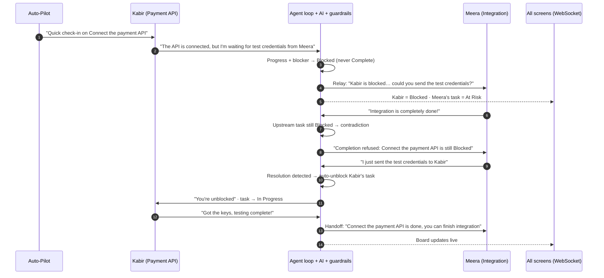

### 8.2 How one reply is processed (`process_reply`)

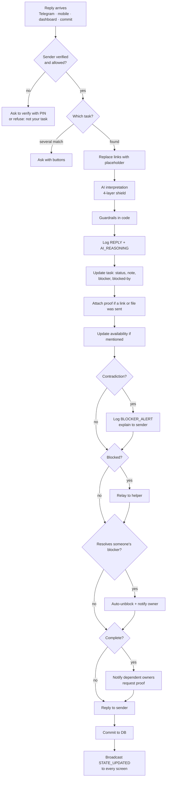

### 8.3 Auto-Pilot cycle and SLA escalation

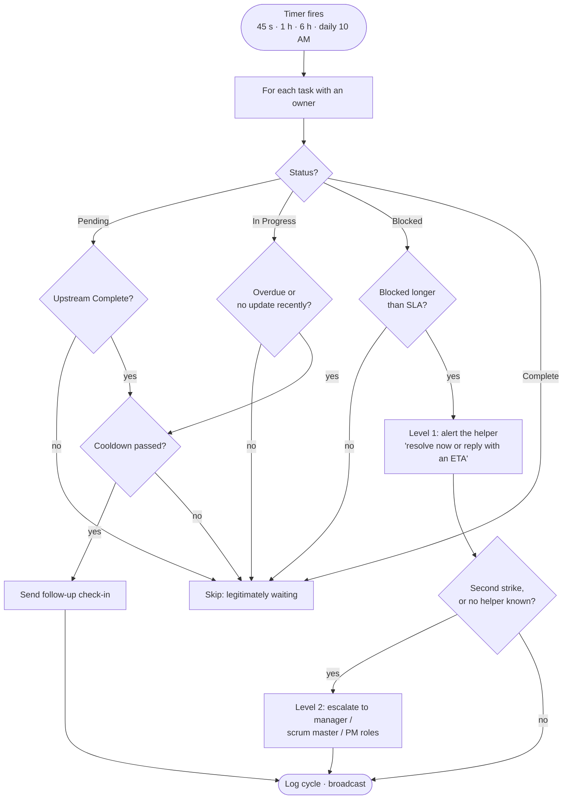

### 8.4 Onboarding: from GitHub repo to briefed team

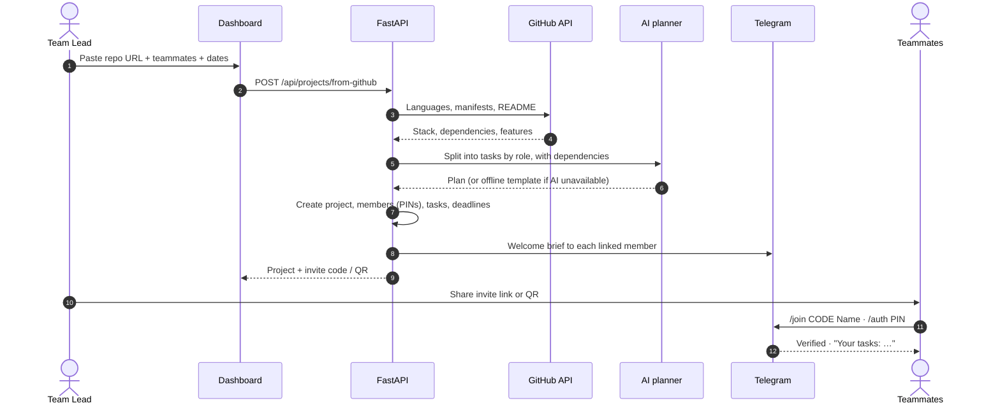

### 8.5 Proof of completion

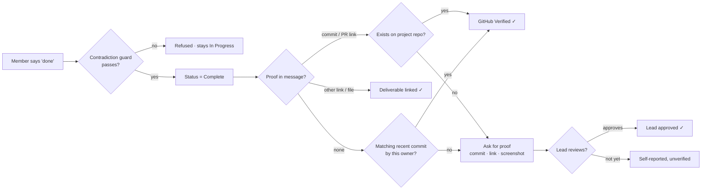

### 8.6 GitHub commit as a status update

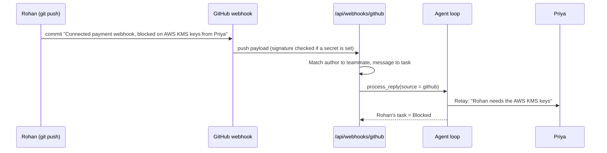

---

## 9. System architecture

### 9.1 High-level architecture

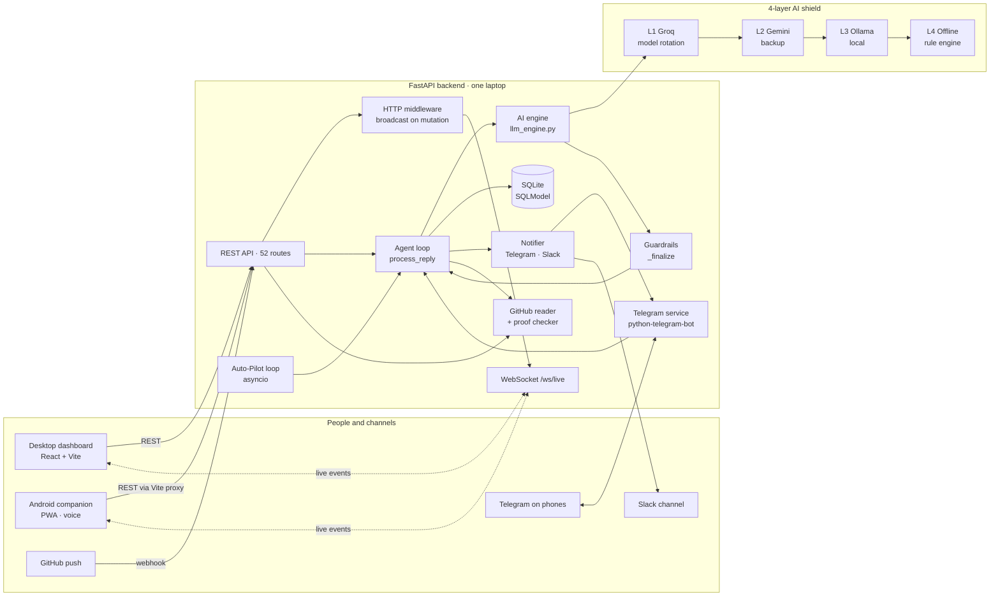

### 9.2 Deployment view (demo setup)

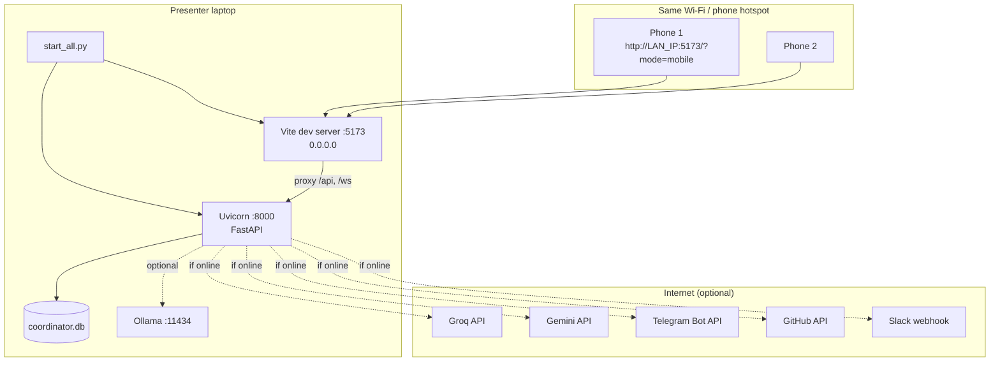

### 9.3 Components

| Component | File | Responsibility |
| --- | --- | --- |
| App and routes | `backend/main.py` | REST API, WebSocket, agent loop, Auto-Pilot, auth routes, integrations |
| AI engine | `backend/llm_engine.py` | 4-layer LLM calls, offline interpreter, guardrails, report, planners, task matching, availability |
| Data model | `backend/models.py` | Tables and insert hooks (PINs, task types) |
| Database | `backend/database.py` | Engine, in-place migrations, backfill |
| Auth | `backend/auth.py` | HMAC-signed tokens, password hashing, invite codes, lead guard |
| Telegram | `backend/telegram_service.py` | Bot commands, buttons, free text, file proof |
| Notifier | `backend/notifier.py` | Outbound Telegram (with retries) and Slack |
| GitHub | `backend/github_repo.py` | Repo analysis, recent commits, commit/PR lookup |
| Proof | `backend/proof.py` | Proof levels, link checks |
| Deadlines | `backend/deadlines.py` | Parse, humanise and distribute deadlines |
| Seeds | `backend/seed.py` | College and company demo presets |
| Frontend shell | `frontend/src/App.jsx` | Login, desktop vs mobile, modals |
| Live state | `frontend/src/hooks/useLiveState.js` | Snapshot + WebSocket + reconnect + polling fallback |
| Launcher | `start_all.py` | Starts both servers, prints LAN URLs |
| Verifier | `verify_demo.py` | End-to-end demo checks over HTTP |

### 9.4 Real-time sync design

1. Any successful `POST`/`PATCH` passes through an HTTP middleware that broadcasts `{"event": "STATE_UPDATED"}` to every WebSocket. Telegram and Auto-Pilot changes call the same broadcaster.
2. Clients do not receive data over the socket, only the signal. They re-fetch `GET /api/state` (debounced 40 ms), so there is one source of truth.
3. Clients reconnect with exponential backoff (max 8 s), send a heartbeat every 15 s to show latency, and poll every 8 s while the socket is down.

---

## 10. AI design

### 10.1 The 4-layer AI shield

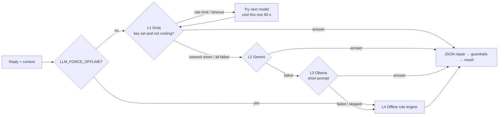

| Layer | Provider | Timeout | Notes |
| --- | --- | --- | --- |
| L1 | Groq (any OpenAI-compatible endpoint) | 6 s | A list of models, rotated on rate limit or timeout; circuit breaker after network errors |
| L2 | Gemini (OpenAI-compatible) | 6 s | Instant backup provider |
| L3 | Ollama on the laptop | 20–25 s | Shorter prompt; skipped for long generations such as whole project plans |
| L4 | Offline Smart Engine | instant | Regex and rules; always available |

Model output passes through `repair_json()`, which strips `<think>` blocks and code fences and extracts the JSON object.

### 10.2 What the interpreter returns

| Field | Meaning |
| --- | --- |
| `new_status` | Pending / In Progress / Blocked / Complete |
| `progress_note` | The real progress, without the blocker ("API is connected") |
| `blocker_reason` | What is missing ("Waiting for test credentials") |
| `blocked_by_teammate_name` | A validated teammate name, or null |
| `auto_relay_target_name`, `auto_relay_message` | Who to message, and what to say |
| `unblocked_downstream_task_id`, `unblocked_notification_message` | Which blocked task this resolves |
| `contradiction_warning` | Why a completion was refused |
| `detected_availability` | "Free after 6 PM", etc. |
| `confidence_score` | 0.0 to 1.0 |
| `reply_to_sender` | A short friendly reply |

### 10.3 Offline Smart Engine signals

- **Done / negated done** ("done", "shipped", vs "not done yet")
- **Blocker** ("waiting for", "stuck", "need", "depends on", Hinglish "baaki hai")
- **Progress** ("working on", "started", "connected")
- **Resolution** ("sent", "shared"), or a message that contains a secret or key
- **Contrast** ("but", "lekin") to split progress from blocker
- **Sarcasm** ("yeah totally done lol")
- **Hinglish** phrases translated with a small dictionary
- **Mentions** of teammate names, to find who to relay to
- **Availability** times converted into a time window

### 10.4 Guardrails (applied to every answer, LLM or offline)

| # | Rule | Why |
| --- | --- | --- |
| 1 | Helping a teammate never marks the helper as Blocked | Small models misread "I sent the keys to Kabir" |
| 2 | Progress + blocker is always Blocked | Prevents false completions and makes the relay possible |
| 3 | A Blocked result always has a blocker reason and a valid teammate, if one exists | No relays to invented names |
| 4 | Auto-unblock only targets a really Blocked task owned by someone else | No accidental unblocks |
| 5 | Contradiction guard refuses completion if the upstream is Blocked (or not Complete in strict mode) | Stops the illusion of progress |
| 6 | If an LLM refused a clear "done" where no rule applies, the code overrules it | No false refusals |
| 7 | Status names normalised, confidence clamped to 0–1, empty replies regenerated | Robust against messy output |

Because the rules are in Python and not in the prompt, the behaviour is the same whichever layer answered.

### 10.5 Other AI features

| Feature | Function | Offline fallback |
| --- | --- | --- |
| Project plan from description | `generate_project_plan` | Role-based template |
| Project plan from GitHub repo | `generate_repo_plan` | Stack- and README-based planner |
| Standup & Risk Report | `generate_project_report` | Computed from the dependency graph |
| Meeting slot finder | `coordinate_team_slots` | Deterministic (no LLM) |
| Message → task matching | `match_task` | Deterministic keyword overlap |

---

## 11. Data model

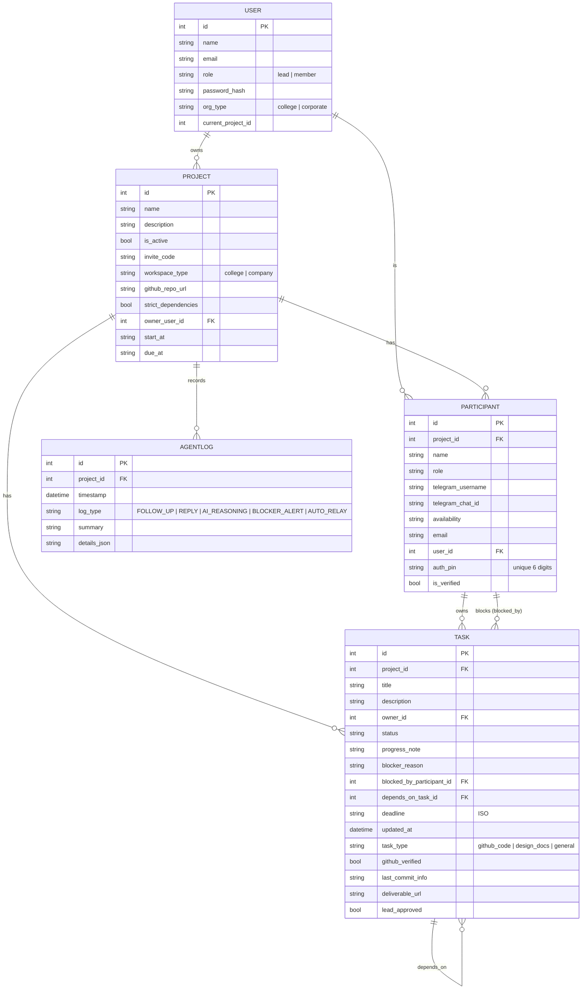

**Data rules**
- Every participant gets a unique 6-digit PIN on insert, unique across all projects.
- Every task is classified by type on insert.
- New columns are added to existing SQLite files in place at startup; older rows are backfilled.

---

## 12. API surface

Full interactive docs: `http://localhost:8000/docs`.

| Area | Endpoints |
| --- | --- |
| **State** | `GET /api/state` · `GET /api/report` · `GET /api/llm-status` · `GET /api/telegram/status` · `GET /api/network-info` |
| **Auth** | `POST /api/auth/login` · `/register-lead` · `/login-lead` · `/join-member` · `/demo` · `GET /api/auth/me` · `GET /api/invites/{code}` |
| **Projects** | `POST /api/projects` · `/{id}/activate` · `PATCH /api/projects/{id}` · `GET /{id}/invite` · `POST /{id}/deadlines` · `/{id}/sync-github` |
| **Planning** | `POST /api/ai/generate-project` · `POST /api/projects/from-github` · `POST /api/import-csv` · `POST /api/presets/load` |
| **Team and tasks** | `POST /api/participants` · `POST /api/tasks` · `PATCH /api/tasks/{id}` · `PATCH /{id}/deadline` · `POST /{id}/override` · `/{id}/review` · `/{id}/deliverable` |
| **Updates** | `POST /api/simulate-reply` · `POST /api/mobile/quick-update` · `GET /api/mobile/my-dashboard/{id}` · `POST /api/take-updates` |
| **Check-ins** | `POST /api/ping-task/{id}` · `POST /api/ping-all-pending` · `POST /api/coordinate-slots` |
| **Auto-Pilot** | `POST /api/autopilot/toggle` · `GET /api/autopilot/status` · `POST /api/autopilot/run-now` |
| **Integrations** | `POST /api/webhooks/github` · `GET/POST /api/integrations` |
| **Demo** | `POST /api/reset-demo` |
| **Live** | `WS /ws/live`: events `CONNECTED`, `STATE_UPDATED`, `PONG` |

### Example: send a reply

```http
POST /api/simulate-reply
{ "participant_name": "Kabir", "message": "The API is connected, but I'm waiting for test credentials from Meera" }
```

```json
{
  "result": {
    "new_status": "Blocked",
    "progress_note": "API is connected",
    "blocker_reason": "Waiting for test credentials",
    "blocked_by_teammate_name": "Meera",
    "auto_relay_target_name": "Meera",
    "contradiction_warning": null,
    "confidence_score": 0.9
  },
  "llm": { "layer": "Primary Cloud LLM", "model": "openai/gpt-oss-120b" },
  "actions": [
    { "type": "TASK_UPDATED", "from": "Pending", "to": "Blocked" },
    { "type": "BLOCKER_RELAYED", "to": "Meera" }
  ]
}
```

---

## 13. Non-functional requirements

| Area | Requirement |
| --- | --- |
| **Reliability** | The core loop must work with no API keys, no internet and no Telegram token (offline engine + Simulator Mode). No AI failure may surface as an error to the user. |
| **Latency** | Cloud LLM calls time out after 6 s before falling back; the offline engine answers instantly. Screens update within about 1 s of a change. |
| **Consistency** | Guardrails give the same result regardless of which AI layer answered. |
| **Real-time** | WebSocket push with auto-reconnect and a polling fallback. |
| **Security** | HMAC-SHA256 signed tokens (14-day expiry); salted password hashes; constant-time comparisons; lead-only routes guarded; Telegram identity proven with a PIN; members can only update their own tasks; GitHub webhook signature checked when a secret is set; secrets kept in `.env`. |
| **Auditability** | Every reply, AI decision (with layer, model and confidence), relay and alert is stored in `AgentLog`. |
| **Portability** | Runs on Windows, macOS and Linux; one command to start; standard-library launcher and verifier. |
| **Mobile** | Phone layout below 768 px; installable PWA; 44 px minimum touch targets. |
| **Data safety** | Schema changes are applied in place without data loss. |
| **Accessibility** | Labelled controls, light and dark themes, readable on a projector. |

---

## 14. Tech stack

| Layer | Technology |
| --- | --- |
| Backend language | Python 3.11+ |
| Web framework | FastAPI, Uvicorn (`uvicorn[standard]` for WebSockets) |
| ORM / validation | SQLModel (SQLAlchemy + Pydantic) |
| Database | SQLite |
| Concurrency | asyncio (Auto-Pilot loop, broadcasts) |
| LLM clients | OpenAI Python SDK (OpenAI-compatible: Groq, Gemini), httpx for Ollama |
| Messaging | python-telegram-bot v22, Slack incoming webhook |
| HTTP | httpx (GitHub, Slack, link checks) |
| Config | python-dotenv |
| Auth | HMAC-SHA256 tokens (standard library) |
| Frontend | React 18, Vite 5 |
| Styling | Tailwind CSS 3, PostCSS, Autoprefixer |
| Icons and QR | lucide-react, qrcode.react |
| Mobile | PWA manifest, Web Speech API (voice dictation) |
| Testing | FastAPI TestClient (`self_test.py`), HTTP verifier (`verify_demo.py`) |

---

## 15. Configuration

All settings live in `backend/.env` (see `.env.example`). Everything is optional.

| Variable | Default | Purpose |
| --- | --- | --- |
| `OPENCODE_BASE_URL`, `OPENCODE_API_KEY`, `OPENCODE_MODEL`, `OPENCODE_FALLBACK_MODELS` | Groq in `.env.example` | Layer 1 LLM and its rotation list |
| `BACKUP_BASE_URL`, `BACKUP_API_KEY`, `BACKUP_MODEL` | Gemini in `.env.example` | Layer 2 LLM |
| `OLLAMA_BASE_URL`, `OLLAMA_MODEL`, `OLLAMA_TIMEOUT_SECONDS`, `OLLAMA_MAX_TOKENS` | empty model = off | Layer 3 local LLM |
| `LLM_TIMEOUT_SECONDS` | 6 | Per-request cloud timeout |
| `LLM_FORCE_OFFLINE` | 0 | Force the offline engine |
| `TELEGRAM_BOT_TOKEN`, `TELEGRAM_DISABLE_POLLING` | unset | Telegram bot |
| `SLACK_WEBHOOK_URL`, `GITHUB_WEBHOOK_SECRET` | unset | Integrations |
| `AUTOPILOT_ON_START`, `AUTOPILOT_INTERVAL_SECONDS` | 0, 45 | Auto-Pilot |
| `BLOCKER_SLA_SECONDS`, `FOLLOWUP_COOLDOWN_SECONDS`, `STALE_IN_PROGRESS_SECONDS` | 90, 90, 120 | Demo-friendly timings (raise for real teams) |
| `AUTH_SECRET`, `AUTH_REQUIRED` | auto-generated file, off | Token signing, enforcing login |
| `DATABASE_URL` | `sqlite:///./coordinator.db` | Database |

---

## 16. Success metrics

| Metric | Target | How measured |
| --- | --- | --- |
| Status accuracy on mixed messages | ≥ 95% classified correctly | `self_test.py` and `verify_demo.py` cases |
| False completions accepted | 0 when upstream is Blocked | Contradiction guard tests |
| Time from blocker reply to relay | < 10 s online, < 1 s offline | `AgentLog` timestamps |
| Time to unblock (blocker → In Progress) | 50% lower than manual chasing | Compare Blocked durations in logs |
| Lead messages sent manually | 80% fewer | Count of manual pings vs Auto-Pilot pings |
| Completions with proof | ≥ 70% verified (github, deliverable or lead) | `proof_level` distribution |
| Demo reliability | 100% of demo steps work offline | `verify_demo.py --offline` |
| Sync latency | < 1 s to all screens | WebSocket event timing |

---

## 17. Testing and acceptance

| Suite | Command | Scope |
| --- | --- | --- |
| Demo verifier | `python verify_demo.py` (`--offline` for no keys) | The judged story, over HTTP against the live API: blocker, relay, contradiction, unblock, completion, handoff, report |
| Backend tests | `cd backend && venv\Scripts\python self_test.py` (`--offline`) | Offline engine always; live LLM layers too when keys are set |
| Smoke test | `python start_all.py --check` | Both servers start and respond |

### Acceptance criteria for the core loop

1. **Given** Kabir's task is Pending, **when** he sends "API is connected, but waiting for test credentials from Meera", **then** his task is Blocked with progress note "API is connected", blocker "Waiting for test credentials", Meera receives a relay, and Meera's dependent task shows at risk.
2. **Given** Kabir's task is Blocked, **when** Meera says "Integration is done", **then** her task stays In Progress, a contradiction warning is logged and she is told why.
3. **When** Meera says "Sent the test credentials to Kabir", **then** Kabir's task moves to In Progress and he is notified.
4. **When** Kabir says "Got the keys, testing complete", **then** his task is Complete and Meera receives a handoff.
5. All of the above produce the same result with `LLM_FORCE_OFFLINE=1`.

---

## 18. Risks and mitigations

| Risk | Impact | Mitigation |
| --- | --- | --- |
| LLM rate limits or outage during the demo | AI stops | 4-layer shield, model rotation, circuit breaker, offline engine |
| LLM misreads a message | Wrong status | Guardrails in code; confidence score; lead override; full audit log |
| Venue Wi-Fi blocks phones or Telegram | Demo breaks | Phone hotspot; Simulator Mode; dashboard Quick Reply Tester |
| Someone updates another person's task | Untrustworthy board | PIN verification on Telegram, per-person permissions |
| Optimistic "done" claims | False progress | Contradiction guard, proof levels, lead review |
| Too many pings annoy people | People mute the bot | Cooldowns, skipping legitimately waiting tasks, SLA levels |
| PWA limits on plain HTTP (no mic, no full-screen install) | Weaker phone experience | Chrome flag for the demo; HTTPS or a native APK later |
| SQLite on one laptop | Not multi-team or cloud ready | Planned move to PostgreSQL and hosted deployment |
| Secrets pasted in chat ("here's the key: sk-…") | Leak into logs | Detected as a resolution signal; planned redaction before storage |

---

## 19. Roadmap

| Phase | Scope |
| --- | --- |
| **v1 (built)** | Everything in section 7 marked Built |
| **v1.1** | Native Android APK via Capacitor; HTTPS for full PWA; redact secrets in logs; production timing defaults |
| **v2** | Two-way Jira/Linear sync; Slack and Microsoft Teams bots with replies; WhatsApp bot; calendar sync for meeting slots |
| **v3** | Hosted multi-team SaaS on PostgreSQL; per-team data isolation and encrypted secrets; delay prediction from team history; voice notes in more Indian languages; analytics for faculty and managers |

---

## 20. Open questions

1. What are the right default SLA and follow-up timings for a real (non-demo) college team versus a company team?
2. Should a lead be able to turn off the contradiction guard for a single task?
3. Should screenshots and files sent as proof be stored on the server, or only linked?
4. How should Coordina handle one person who belongs to several projects on the same Telegram account?
5. Is a native APK required for evaluation, or is the PWA sufficient?
