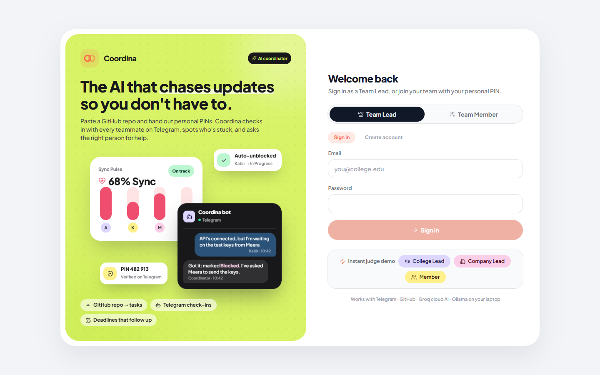
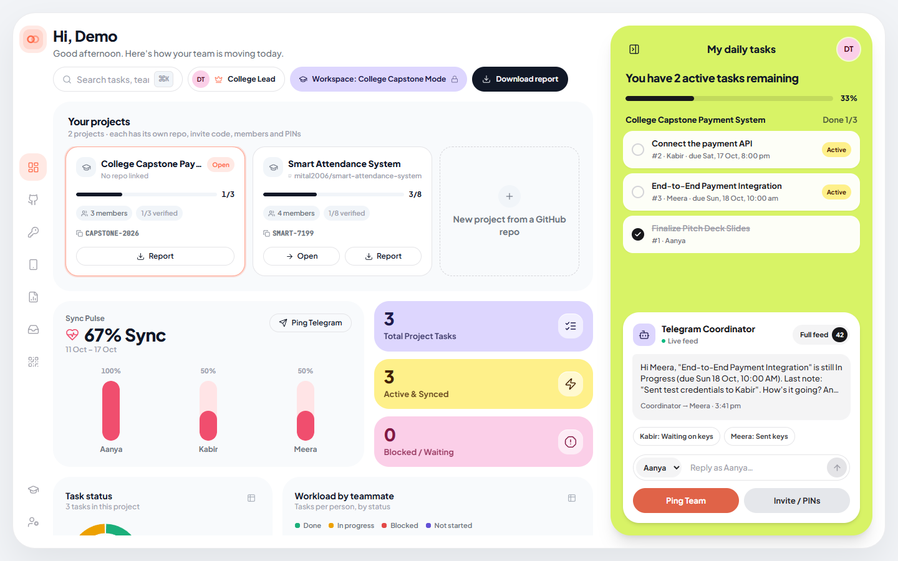
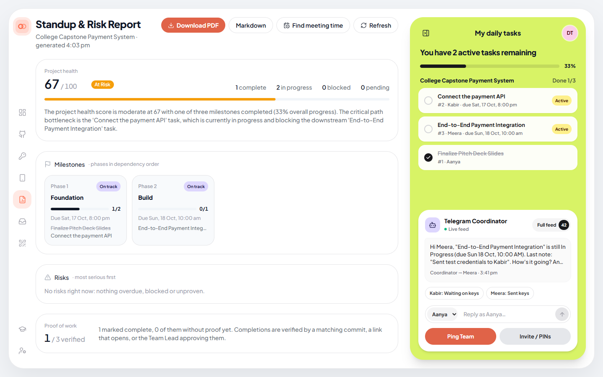
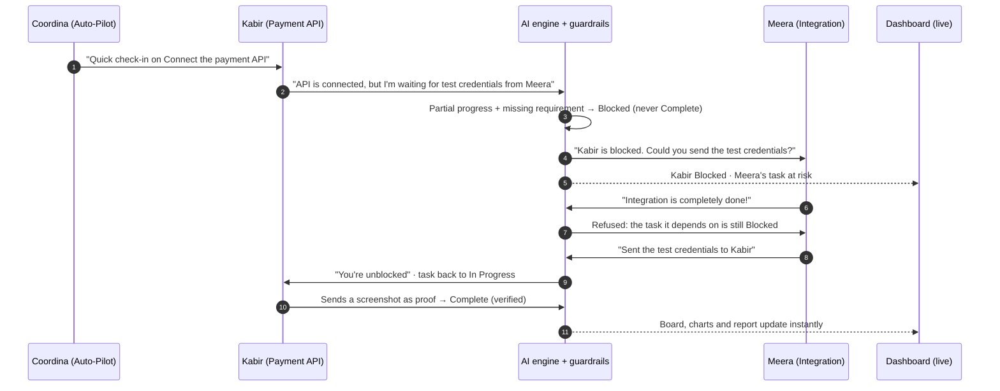
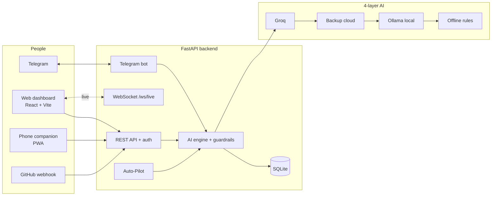

<div align="center">

# Coordina

### The AI that chases updates so you don't have to.

An AI group-project coordinator for college teams and company sprints.<br/>
Paste a GitHub repo, hand out personal PINs, and Coordina checks in with every teammate on Telegram,
spots who's stuck, asks the right person for help, and checks that "done" really means done.

**Hackathon problem statement W-PS-1 · AI Group Project Coordinator**




</div>

---

## Table of contents

- [Why Coordina](#why-coordina)
- [What it does](#what-it-does)
- [Screenshots](#screenshots)
- [How it works](#how-it-works)
- [Quick start (5 minutes)](#quick-start-5-minutes)
- [Configuration (`backend/.env`)](#configuration-backendenv)
- [Setting up the Telegram bot](#setting-up-the-telegram-bot)
- [Using Coordina](#using-coordina)
- [Telegram commands](#telegram-commands)
- [Running the tests](#running-the-tests)
- [Demo script for judges](#demo-script-for-judges)
- [Project structure](#project-structure)
- [API reference](#api-reference)
- [Troubleshooting](#troubleshooting)
- [Security notes](#security-notes)

---

## Why Coordina

Group projects rarely fail because the work is hard. They fail because nobody knows **who is stuck**,
**who they are waiting on**, or whether *"basically done"* actually means done. The Team Lead ends up
chasing everyone on WhatsApp.

Coordina takes over that follow-up loop:

```
Check-in  →  Teammate replies (any wording)  →  AI understands it  →  Blocked? Ask the person who can unblock it  →  Board updates live
```

---

## What it does

### For the Team Lead
| Feature | What you get |
| --- | --- |
| **GitHub repo → task plan** | Paste a repo URL. The AI reads it and splits the work into tasks with owners, dependencies and roles. |
| **Many projects per lead** | Run 3, 4 or more projects at once. Each has its own repo, invite code, members, PINs and report. All of them appear as cards on the dashboard. |
| **Deadlines the AI spreads for you** | Set the project deadline. The AI spreads task deadlines in dependency order across working hours, and you can edit any of them. |
| **Proof of work** | A "done" only counts fully when it's proven: a matching **GitHub commit/PR**, a **working link** (slides, Figma, demo), a **photo or file sent on Telegram**, or **your approval**. |
| **Blocker chasing** | When someone says *"waiting for test credentials from Meera"*, Coordina messages Meera and keeps reminding her until it's done. |
| **Task requests** | Members can ask for a new task (for themselves or a teammate) before or after one of theirs. You approve or decline from the dashboard inbox. |
| **Edit & delete tasks** | Rename, re-describe, reassign or discard any task. Owners are told on Telegram, and dependency chains are re-linked automatically. |
| **Milestones, risks & reports** | Health score, phases, critical path, overdue/blocked/unproven risks, handoffs, and a **one-click PDF or Markdown report** for each project. |
| **Auto-Pilot** | Hands-free check-ins on pending and stale tasks, blocker reminders, and proof reminders. |

### For team members
- Verify once on Telegram with a **personal 6-digit PIN** (a different PIN for each project).
- Reply in plain language, including English, Hinglish or one-word answers. The AI works out the status.
- Send proof as a link, photo or file right in the chat.
- Request tasks with `/request` and see the team board with `/status`.

### Two workspaces, strictly separated
| Account | Workspace | Demo data |
| --- | --- | --- |
| **College Team Lead** | College Capstone Mode | Student project (pitch deck, payment API, integration) |
| **Company Team Lead** | Corporate Workspace | FinTech sprint with company roles, CSV import, GitHub webhooks |

A college lead can't open the corporate workspace, and a company lead can't open the college one. Each lead sees **only their own projects**.

### Only the Team Lead can approve or download
Downloading reports, approving task requests and proof, setting deadlines, pinging, and editing or deleting tasks are **Team Lead only**. The server enforces this for both College and Company leads. Members can still send updates, proof and requests.

### An AI that never goes down
| Layer | Engine | When it's used |
| --- | --- | --- |
| 1 | **Groq** free cloud models (`gpt-oss-120b` → `gpt-oss-20b` → `qwen`) | Normally. It rotates models on rate limits or timeouts. |
| 2 | Backup cloud LLM (optional, any OpenAI-compatible API) | If Groq is unavailable |
| 3 | **Ollama** on your laptop (`qwen2.5:1.5b`) | No internet? It still works. |
| 4 | Offline rule engine | Always available, so the demo never breaks |

Every AI answer passes through **guardrails in code**:
- Partial work plus waiting means *Blocked*, never *Complete*.
- Questions and "okay" are never treated as blockers.
- You can't complete a task whose upstream task is still open.
- Helping a teammate doesn't complete your own task.
- Internal task IDs never appear in messages.

---

## Screenshots

| Lead dashboard (all projects, charts, live Telegram feed) | Standup & risk report (PDF / Markdown download) |
| --- | --- |
|  |  |

---

## How it works





**Stack:**
- **Backend:** Python 3.11, FastAPI, SQLModel/SQLite, python-telegram-bot v22, OpenAI-compatible clients, fpdf2.
- **Frontend:** React 18, Vite 5, Tailwind CSS, lucide-react.

---

## Quick start (5 minutes)

### Prerequisites
- **Python 3.11+** ([python.org](https://www.python.org/downloads/)). On Windows, tick *"Add Python to PATH"* during install.
- **Node.js 18+** ([nodejs.org](https://nodejs.org/))
- **Git**
- *Optional:* a free **Groq API key**, a **Telegram bot token**, and **Ollama**. See [Configuration](#configuration-backendenv).

### 1. Clone

```bash
git clone https://github.com/Sam786-web/coordina.git
cd coordina
```

### 2. Backend

**Windows (PowerShell or CMD)**
```bash
cd backend
python -m venv venv
venv\Scripts\activate
pip install -r requirements.txt
copy .env.example .env
cd ..
```

**macOS / Linux**
```bash
cd backend
python3 -m venv venv
source venv/bin/activate
pip install -r requirements.txt
cp .env.example .env
cd ..
```

### 3. Frontend

```bash
cd frontend
npm install
cd ..
```

### 4. Run everything

```bash
python start_all.py
```

This starts the backend and frontend together and prints:

```
💻  Desktop dashboard:      http://localhost:5173
📱  Phone companion app:    http://<YOUR_LAN_IP>:5173/?mode=mobile
🤖  API & Swagger docs:     http://localhost:8000/docs
```

Open **http://localhost:5173**, then click **Instant judge demo → College Lead** (or **Company Lead**) to explore with sample data right away.

| Launcher option | What it does |
| --- | --- |
| `--open` | Opens the dashboard in your browser once it's ready |
| `--api-port 8001 --web-port 5174` | Uses different ports |
| `--check` | Starts both servers, checks they respond, then stops |

Press **Ctrl+C** to stop both.

<details>
<summary><b>Run backend and frontend separately instead</b></summary>

```bash
# Terminal 1
cd backend
venv\Scripts\activate          # macOS/Linux: source venv/bin/activate
uvicorn main:app --port 8000

# Terminal 2
cd frontend
npm run dev
```
</details>

> **Works with no keys at all.** Without any API keys, Coordina uses the offline engine, and Telegram runs in simulator mode. Add keys for the full experience.

---

## Configuration (`backend/.env`)

Copy `backend/.env.example` to `backend/.env` and fill in what you need. **Never commit `.env`**, because it's already in `.gitignore`.

### AI (all optional)

| Variable | Purpose |
| --- | --- |
| `OPENCODE_BASE_URL` | Main AI endpoint (any OpenAI-compatible API). Default: `https://api.groq.com/openai/v1`. |
| `OPENCODE_API_KEY` | Your **free Groq key** from [console.groq.com/keys](https://console.groq.com/keys). *(The `OPENCODE_*` names are historical.)* |
| `OPENCODE_MODEL` | Default `openai/gpt-oss-120b` |
| `OPENCODE_FALLBACK_MODELS` | Models tried next on rate limits: `openai/gpt-oss-20b,qwen/qwen3.8-27b` |
| `BACKUP_BASE_URL`, `BACKUP_API_KEY`, `BACKUP_MODEL` | Optional second cloud provider (for example Gemini). Leave the key empty to skip it. |
| `OLLAMA_BASE_URL`, `OLLAMA_MODEL` | Local AI. Default `http://localhost:11434` and `qwen2.5:1.5b`. |
| `OLLAMA_TIMEOUT_SECONDS`, `OLLAMA_MAX_TOKENS` | Defaults `20` and `400`. CPU laptops are slower. |
| `LLM_TIMEOUT_SECONDS` | Per-request cloud timeout before rotating models (default `6`) |
| `LLM_FORCE_OFFLINE=1` | Forces the offline engine, for rehearsals on bad Wi-Fi |

**Set up local AI with Ollama (recommended for hackathons):**
1. Install Ollama from [ollama.com](https://ollama.com/download).
2. Run `ollama pull qwen2.5:1.5b` (about 1 GB).
3. Keep Ollama running. Coordina warms the model up at startup and uses it whenever the cloud is unreachable.

### Telegram

| Variable | Purpose |
| --- | --- |
| `TELEGRAM_BOT_TOKEN` | Token from [@BotFather](https://t.me/BotFather). If it's empty, the bot runs in simulator mode. |
| `TELEGRAM_DISABLE_POLLING=1` | Don't start the bot, for example on a second backend instance |

### Integrations & Auto-Pilot (optional)

| Variable | Purpose |
| --- | --- |
| `GITHUB_TOKEN` | A GitHub personal access token for higher API limits and private repos when reading repos and verifying commits |
| `GITHUB_WEBHOOK_SECRET` | Verifies real GitHub push webhook signatures |
| `SLACK_WEBHOOK_URL` | Mirrors relays and escalations into a Slack channel |
| `AUTOPILOT_ON_START` | Set to `1` to start Auto-Pilot automatically |
| `AUTOPILOT_INTERVAL_SECONDS`, `BLOCKER_SLA_SECONDS`, `FOLLOWUP_COOLDOWN_SECONDS`, `STALE_IN_PROGRESS_SECONDS` | Auto-Pilot timing. The defaults are short, for demos. |
| `DATABASE_URL` | Default `sqlite:///./coordinator.db` |
| `AUTH_SECRET` | Optional fixed secret for signing sign-in tokens. One is generated automatically if it's not set. |
| `AUTH_REQUIRED=1` | Refuse anonymous API calls to lead actions. Use it when deploying publicly. |

---

## Setting up the Telegram bot

1. In Telegram, open **[@BotFather](https://t.me/BotFather)**, send `/newbot`, and follow the prompts.
2. Copy the token into `backend/.env` as `TELEGRAM_BOT_TOKEN=...` and restart `start_all.py`.
3. *(For group chats only)* In BotFather, run `/setprivacy` → your bot → **Disable**, so the bot can read normal messages.
4. The dashboard shows the bot as **Live**. The command menu (`/auth`, `/status`, …) is registered automatically.

**How teammates join:**
1. The Team Lead opens **Invite / PINs** on the dashboard. Every member has a personal **6-digit PIN** for that project.
2. The teammate opens the bot and sends `/auth 482913` (or just the 6 digits), or taps the 1-tap link from the Invite panel.
3. Done. They can now reply to check-ins in plain language.

> **Same person in several projects?** Each project gives them a different PIN. Their messages update the project whose PIN they sent last. To switch, they send the other project's PIN. They still get reminders from every project they've verified in.

---

## Using Coordina

### As a Team Lead
1. **Create an account:** choose *Team Lead → Create account* and pick **College** or **Company**.
2. **Create a project:** click **New project from a GitHub repo**, paste the repo URL and add your teammates, then click **Analyze repo & split tasks**. (You can also start from a name and description and let the AI plan the tasks.)
3. **Set the deadline:** open **Deadlines**, set the project end date, and let the AI spread task deadlines. Edit any of them.
4. **Invite the team:** open **Invite / PINs** and share each person's PIN or 1-tap Telegram link.
5. **Let it run:** use **Ping Team**, or switch on **Auto-Pilot**. Watch the board, charts and feed update live.
6. **Review:** filter by **Needs review** to approve completions or reopen them with a reason. Answer **task requests** from the inbox in the side rail.
7. **Report:** click **Download report** on the dashboard (current project) or **Report** on any project card.

### As a team member
- **On the web:** choose *Team Member*, then enter the project invite code and your PIN.
- **On Telegram:** send `/auth <PIN>`, then just reply naturally:
  - *"Started on the login page"* → **In Progress**
  - *"API connected but waiting for keys from Meera"* → **Blocked**, and Meera is asked to help
  - *"Done, here's the PR: github.com/…/pull/12"* → **Complete**, verified by GitHub
  - Send a **screenshot or file** → attached as proof

---

## Telegram commands

| Command | What it does |
| --- | --- |
| `/start` | Welcome message (shows no project data until you verify) |
| `/auth <PIN>` | Verify with your 6-digit PIN, or switch to another project |
| `/status` | Your team's task board, in work order |
| `/slot` | Share when you're free, so the lead can find a meeting time |
| `/request` | Ask the Team Lead to add a task (for example `/request MITAL: set up the staging DB - for load tests`, then pick where it goes) |
| `/end` | Sign out of every project, to verify again or as someone else |
| *any text* | A progress update. The AI works out which task it's about, or asks you. |
| *photo / file* | Proof of work for one of your tasks |

---

## Running the tests

With the backend virtual environment active:

```bash
# Backend test suite (67 checks): AI guardrails, access control, deadlines, proof, requests
cd backend
python self_test.py

# Hackathon rubric checks against the live API (7 checks)
cd ..
python verify_demo.py
```

> `verify_demo.py` resets the **demo** projects. Run it against a test database, or before you add real data.

---

## Demo script for judges

| Time | Show | Say |
| --- | --- | --- |
| **0:00** | Sign-in → **Instant judge demo → College Lead**. The dashboard shows project cards, charts and the live feed. | "One lead, several projects, each with its own repo, PINs and report." |
| **0:30** | **Ping Team** (or Auto-Pilot on) | "Coordina does the chasing, on Telegram." |
| **1:00** | Kabir replies: *"API is connected, but I'm waiting for test credentials from Meera."* | "A mixed message. Most tools would call this done." |
| **1:30** | Kabir → **Blocked** (progress note kept), and Meera is asked for the credentials. Meera's task turns **At Risk**. | "It separated progress from the blocker and messaged the one person who can fix it." |
| **2:15** | Meera claims *"Integration is done!"* → refused | "The task it depends on is still blocked, so there's no fake progress." |
| **2:45** | Meera: *"Sent the credentials to Kabir"* → Kabir auto-unblocked | "And Kabir is told right away." |
| **3:15** | Kabir sends a screenshot as proof → **Complete · verified** | "Done means proven: a commit, a link, a file, or the lead's approval." |
| **3:45** | A member sends `/request` → it appears in the lead's inbox → **Approve** | "Teammates can ask for work. The lead stays in control." |
| **4:15** | **Download report** → the PDF opens | "A standup and risk report in one click." |
| **4:40** | Sign in as **Company Lead** | "The same engine for a company sprint, in a separate, locked workspace." |

**Backup plan:**
- Every reply can be typed in the dashboard's reply box (the *Reply as…* selector) if a phone misbehaves.
- `LLM_FORCE_OFFLINE=1` keeps the AI working without internet.

---

## Project structure

```
coordina/
├── start_all.py            One-command launcher (backend + frontend)
├── verify_demo.py          W-PS-1 rubric verifier
├── backend/
│   ├── main.py             FastAPI app: REST API, auth & access control, WebSocket, Auto-Pilot
│   ├── llm_engine.py       4-layer AI engine, reply interpreter, guardrails, planner, reports
│   ├── telegram_service.py Telegram bot: /auth, /status, /request, /end, proof uploads
│   ├── notifier.py         Outbound Telegram / Slack with retries
│   ├── deadlines.py        Deadline parsing and AI spreading across dependencies
│   ├── proof.py            Proof-of-work levels, link checks, GitHub commit/PR verification
│   ├── insights.py         Work order, milestones, risks, report content
│   ├── pdf_report.py       PDF progress report
│   ├── github_repo.py      Reads GitHub repos and commits
│   ├── models.py           SQLModel tables (users, projects, members, tasks, requests, logs)
│   ├── database.py         SQLite setup and automatic migrations
│   ├── seed.py             Demo projects
│   ├── self_test.py        Backend test suite
│   ├── requirements.txt
│   └── .env.example        Copy to .env
├── frontend/
│   ├── src/App.jsx         App shell, routing between views, modals
│   ├── src/components/     Dashboard, projects board, charts, report, rail, Telegram feed, modals
│   ├── src/lib/            API client, auth, downloads, task helpers
│   └── public/             PWA manifest and icons
└── docs/                   README screenshots
```

---

## API reference

Interactive docs: **http://localhost:8000/docs**

| Area | Endpoints |
| --- | --- |
| Auth | `POST /api/auth/register-lead`, `/login-lead`, `/join-member`, `/demo`, `GET /api/auth/me` |
| Projects | `GET /api/state`, `GET /api/projects/summary`, `POST /api/projects/from-github`, `POST /api/ai/generate-project`, `POST /api/projects/{id}/activate`, `PATCH /api/projects/{id}` |
| Tasks | `POST /api/tasks`, `PATCH /api/tasks/{id}`, `DELETE /api/tasks/{id}`, `POST /api/tasks/{id}/override`, `POST /api/tasks/{id}/review`, `POST /api/tasks/{id}/deliverable` |
| Deadlines | `POST /api/projects/{id}/deadlines`, `PATCH /api/tasks/{id}/deadline` |
| Task requests | `POST /api/task-requests`, `GET /api/task-requests`, `POST /api/task-requests/{id}/decide` |
| Coordination | `POST /api/simulate-reply`, `POST /api/ping-task/{id}`, `POST /api/ping-all-pending`, `POST /api/take-updates`, `POST /api/coordinate-slots` |
| Reports | `GET /api/report`, `GET /api/report.pdf?project_id=`, `GET /api/report.md?project_id=` |
| Auto-Pilot | `POST /api/autopilot/toggle`, `GET /api/autopilot/status`, `POST /api/autopilot/run-now` |
| Integrations | `POST /api/webhooks/github`, `POST /api/import-csv`, `POST /api/projects/{id}/sync-github` |
| Status | `GET /api/llm-status`, `GET /api/telegram/status`, `GET /api/network-info` |
| Live | `WS /ws/live` (pushes `STATE_UPDATED`) |

---

## Troubleshooting

| Problem | Fix |
| --- | --- |
| `python` not found (Windows) | Reinstall Python with *Add to PATH* ticked, or use `py -3.11` instead of `python`. |
| `venv\Scripts\activate` blocked in PowerShell | Run `Set-ExecutionPolicy -Scope CurrentUser RemoteSigned` once, or use CMD. |
| Port already in use | Another copy is running. Stop it, or run `python start_all.py --api-port 8001 --web-port 5174`. |
| Dashboard says *Reconnecting* | The backend isn't running. Check the terminal for errors, and run `pip install -r backend/requirements.txt`. |
| AI status shows *Offline engine* | Check `OPENCODE_API_KEY`. If Groq is rate-limited, Coordina rotates models and falls back to Ollama automatically. |
| Ollama layer not used | Make sure Ollama is running and `ollama list` shows `qwen2.5:1.5b`. |
| Telegram says *"not verified"* | The teammate must send `/auth <PIN>` for **this** project. PINs are different for each project. |
| Bot doesn't reply in a group | In BotFather, set `/setprivacy` → **Disable**. |
| Phone can't open the app | The laptop and phone must be on the same Wi-Fi (or the phone's hotspot). Allow Python through Windows Firewall on private networks. |

---

## Security notes

- **Secrets stay local.** `backend/.env`, the SQLite database, uploaded proof files and the auth secret are all in `.gitignore`.
- **Passwords** are hashed with PBKDF2-SHA256 (240k iterations). Sign-in tokens are HMAC-signed.
- **PINs** are unique 6-digit numbers, one for each member in each project. Telegram links only after `/auth` with that project's PIN.
- **Access control is enforced on the server:** members can't approve, download, edit or delete, and leads can only see their own projects.
- If you ever paste an API key somewhere public, **create a new one** in the provider's console.

---

<div align="center">

Built for the hackathon · **W-PS-1 AI Group Project Coordinator**

</div>
