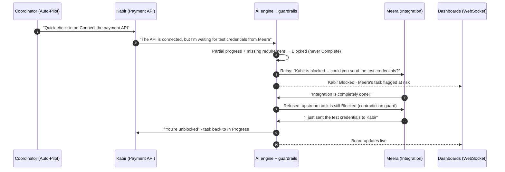
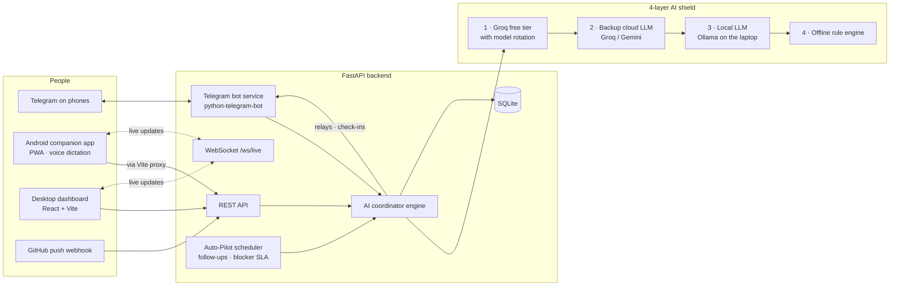

# Coordina — Autonomous AI Project & Team Coordinator

**Hackathon problem statement W-PS-1.** Group projects rarely fail because the work is hard. They fail because nobody knows who is stuck, who they are waiting on, or whether "basically done" actually means done.

Coordina is an AI coordinator that runs the follow-up loop for a team. It checks in with each teammate, understands messy replies (English, Hinglish, sarcasm, voice notes), separates real progress from blockers, catches claims that contradict the dependency graph, and messages the teammate who can unblock the work — without anyone having to chase anyone.

It works for a college capstone team and for a company sprint, from a desktop dashboard, an Android companion app, Telegram, and even GitHub commits.

---

## The core loop

```
Task follow-up  →  Participant reply  →  Blocker disambiguation  →  Autonomous cross-teammate relay  →  Status update
```



### The rules that make it trustworthy

| Rule | What it does |
| --- | --- |
| **Partial progress vs. blocker** | "API is connected, *but* waiting for credentials" becomes `Blocked` with `progress_note = "API is connected"` and `blocker_reason = "Waiting for test credentials"`. Mixed messages are never marked Complete. |
| **Contradiction guard** | A teammate can't complete a task whose upstream dependency is still open. The claim is refused, explained, and logged. |
| **Autonomous relay** | When a blocker names (or implies) a teammate, the coordinator messages that teammate directly with exactly what is needed. |
| **Auto-unblock** | When the helper replies ("sent the credentials to Kabir"), the blocked task moves back to `In Progress` and its owner is told immediately. |

These rules are enforced in code on top of every LLM answer, so the behaviour is identical whether the reply was interpreted by a cloud model or the offline engine.

---

## Architecture



**Stack:** Python 3.11 · FastAPI · SQLModel/SQLite · python-telegram-bot v22 · OpenAI-compatible LLM clients · React 18 · Vite 5 · Tailwind CSS · lucide-react.

---

## Key features

- **Clean, focused dashboard.** Three columns: workspace and team on the left, tasks with a readable dependency flow in the centre, and a chat-style coordinator feed on the right. Light and dark themes for whichever reads better on the projector.
- **Real-time sync.** Every change — from the dashboard, a phone, Telegram, a commit, or Auto-Pilot — is pushed to all screens over a WebSocket.
- **Hands-free Auto-Pilot standups.** Turn it on and the coordinator follows up on pending and stale tasks by itself, and escalates blockers that exceed their SLA: first to the teammate who can fix it, then to the engineering manager.
- **Android companion app (PWA).** Teammates see their tasks, report issues, send updates (with voice dictation in English or Hinglish), and set their availability. When someone is blocked on you, a banner lets you unblock them in one tap.
- **4-layer zero-fail AI shield.** Groq's free models with automatic rotation on rate limits or timeouts, Gemini as an instant backup provider, a local Ollama model on the laptop, and an offline rule engine — so the live demo works even if the Wi-Fi drops. Every model answer also goes through JSON repair to clean up messy output.
- **Company sprint mode.** One click loads a realistic FinTech release with company roles. Import Jira/Linear sprints from CSV, and let GitHub commits like *"Connected payment webhook, blocked on AWS KMS keys from Priya"* update the board and ping Priya.
- **Standup & risk report.** Health score, critical-path bottlenecks, work at risk, handoffs, and recommended next actions, plus a per-member standup.

---

## Setup

**Prerequisites:** Python 3.11+, Node.js 18+, and Git.

```bash
# 1. Backend
cd backend
python -m venv venv
venv\Scripts\activate            # Windows   (macOS/Linux: source venv/bin/activate)
pip install -r requirements.txt
copy .env.example .env           # macOS/Linux: cp .env.example .env

# 2. Frontend
cd ../frontend
npm install
```

### Configure `backend/.env`

Everything works without keys (Offline Smart Engine + Telegram simulator). Add keys for the full experience:

| Variable | Purpose |
| --- | --- |
| `OPENCODE_API_KEY` | Layer 1 AI. Get a key at [opencode.ai](https://opencode.ai). `OPENCODE_MODEL` defaults to `minimax-m2.5-free`, with `OPENCODE_FALLBACK_MODELS` tried in order. |
| `BACKUP_API_KEY` | Layer 2 AI (Groq by default; Gemini works via `BACKUP_BASE_URL`). |
| `OLLAMA_MODEL` | Optional Layer 3 AI: a local model (e.g. `qwen2.5:1.5b`) served by [Ollama](https://ollama.com) at `OLLAMA_BASE_URL`. Leave empty to skip this layer. |
| `TELEGRAM_BOT_TOKEN` | Real Telegram bot. Create one with [@BotFather](https://t.me/BotFather). For group chats, run `/setprivacy` → *Disable* so the bot can read normal messages. |
| `LLM_FORCE_OFFLINE=1` | Optional: force the offline engine (useful for rehearsals on bad Wi-Fi). |
| `SLACK_WEBHOOK_URL`, `GITHUB_WEBHOOK_SECRET` | Optional integrations. |

### Run

```bash
python start_all.py          # from the project root
```

This starts the backend and the frontend together, finds your laptop's network address, and prints:

```
💻  Desktop Mission Control:       http://localhost:5173
📱  Android Phones Companion App:  http://<LAN_IP>:5173/?mode=mobile
🤖  API & Swagger Docs:            http://localhost:8000/docs
```

Press **Ctrl+C** to stop both. Use `--open` to open the dashboard automatically.

### Verify

```bash
python verify_demo.py        # W-PS-1 rubric checks against the live API (7 checks, 27 assertions)
cd backend && venv\Scripts\python self_test.py   # broader backend test suite (49 checks)
```

`verify_demo.py` uses the running backend if there is one, otherwise it starts a temporary one. It resets the demo data and leaves the Student Project preset active.

---

## Connecting physical Android phones

1. **Use one network.** Put the laptop and both phones on the same Wi-Fi, or turn on a phone hotspot and connect the laptop to it (most reliable at venues).
2. **Start Coordina** with `python start_all.py`. If Windows Firewall asks, allow access on private networks.
3. **Open Connect Phones (QR)** in the dashboard sidebar. The app QR code already contains the laptop's address; edit the IP field if you switch networks.
4. **Scan with Android Chrome**, then tap **⋮ → Add to Home screen**.
5. **Pick your name** in *Viewing as*. The phone remembers it.
6. **Link Telegram** (optional): scan the Telegram QR, tap **Start**, and send `/join <YourName>`.

> **Voice dictation and full-screen install need a secure origin.** Over plain `http://192.168.x.x`, Chrome blocks the microphone and installs the app as a browser shortcut. For the demo, open `chrome://flags/#unsafely-treat-insecure-origin-as-secure` on each phone, add `http://<LAN_IP>:5173`, and restart Chrome — or serve the app over HTTPS.

---

## 5-minute live demo script

| Time | What to show | What to say |
| --- | --- | --- |
| **0:00** | Dashboard, *Student Project* preset. Pitch deck Complete, Payment API Pending, Integration In Progress and dependent on it. | "Three teammates, one dependency chain. Meera can't finish until Kabir does." |
| **0:30** | Click **Send Check-ins** (or turn on **Auto-Pilot Check-ins**). | "The coordinator does the chasing — on Telegram, without anyone clicking." |
| **1:00** | On Kabir's phone: **Report Issue** → *"API is connected, but I'm waiting for test credentials from Meera."* | "A mixed message. Most tools would mark this done." |
| **1:30** | Dashboard: Kabir **Blocked**, latest note "API is connected", blocker "Waiting for test credentials", coordinator action "requested the test credentials from Meera". Meera's task turns **At Risk**. Open the conversation feed. | "It separated real progress from the blocker, and messaged the one person who can fix it." |
| **2:15** | On Meera's phone: tap **Complete** on her integration task. | "Now a curveball: Meera claims she's done." |
| **2:30** | The phone shows the refusal: upstream task still Blocked. | "The contradiction guard won't allow an illusion of progress." |
| **3:00** | Meera's phone shows **Kabir is blocked on Connect the payment API** → tap **Send Test Credentials & Unblock**. | "One tap. The coordinator unblocks Kabir and tells him." |
| **3:30** | Kabir's task returns to **In Progress** on every screen. Kabir sends *"Got the keys, testing complete!"* → Complete, and Meera gets a handoff message. | "Real-time across laptop, phones and Telegram." |
| **4:00** | Open **Standup & Risk Report**. | "A standup and risk report, generated from the conversation." |
| **4:30** | Switch to **Company Sprint**. In **Import CSV / GitHub**, send the commit *"Connected payment webhook, blocked on AWS KMS keys from Priya"*. | "Same brain for a real engineering team — even commits feed it." |

**Backup plan:** every step can be driven from the dashboard's *Quick Reply Tester* if a phone misbehaves, and `LLM_FORCE_OFFLINE=1` keeps the AI working without internet. **Reset demo data** is at the bottom of the project dropdown.

---

## Project structure

```
backend/
  main.py              FastAPI app: REST API, WebSocket, Auto-Pilot, presets, integrations
  llm_engine.py        4-layer AI engine, reply interpreter and guardrails, reports, planner
  telegram_service.py  Telegram bot (/start, /join, /status, /slot, natural replies)
  notifier.py          Outbound Telegram and Slack messages
  models.py, database.py, seed.py
  self_test.py         Backend test suite
frontend/
  src/App.jsx          Desktop dashboard and mobile app shells
  src/components/      Sidebar, tasks, report, activity feed, MobileAppView, modals
  public/manifest.json PWA manifest and icons
start_all.py           One-command launcher
verify_demo.py         W-PS-1 rubric verifier
```

## Main API endpoints

| Endpoint | Purpose |
| --- | --- |
| `GET /api/state` | Active project, tasks (with `is_at_risk`), participants, latest agent logs |
| `POST /api/simulate-reply` | Run a teammate's reply through the coordinator (also used by the apps) |
| `POST /api/ping-task/{id}`, `POST /api/ping-all-pending` | Send follow-up check-ins |
| `POST /api/autopilot/toggle`, `GET /api/autopilot/status` | Hands-free standups and blocker SLA |
| `POST /api/presets/load` | `college` or `enterprise` demo data |
| `GET /api/report` | Health, bottlenecks, cascading risks, handoffs, next actions |
| `POST /api/webhooks/github`, `POST /api/import-csv` | Integrations |
| `GET /api/mobile/my-dashboard/{id}`, `POST /api/mobile/quick-update` | Android companion app |
| `GET /api/network-info` | LAN address and links for phone setup |
| `WS /ws/live` | `STATE_UPDATED` push events |

Full interactive docs: `http://localhost:8000/docs`.

## Troubleshooting

- **Phone can't load the app:** confirm both devices are on the same network, the IP in *Connect Phones* matches the laptop, and the firewall allows port 5173.
- **Dashboard says "Reconnecting":** the backend isn't running, or was started without WebSocket support. Run `pip install -r backend/requirements.txt` (it includes `uvicorn[standard]`).
- **Telegram messages say "Not sent":** the bot token is missing, or that teammate hasn't sent `/join <Name>` yet.
- **Port already in use:** another copy is running. Stop it, or use `python start_all.py --api-port 8001 --web-port 5174`.
